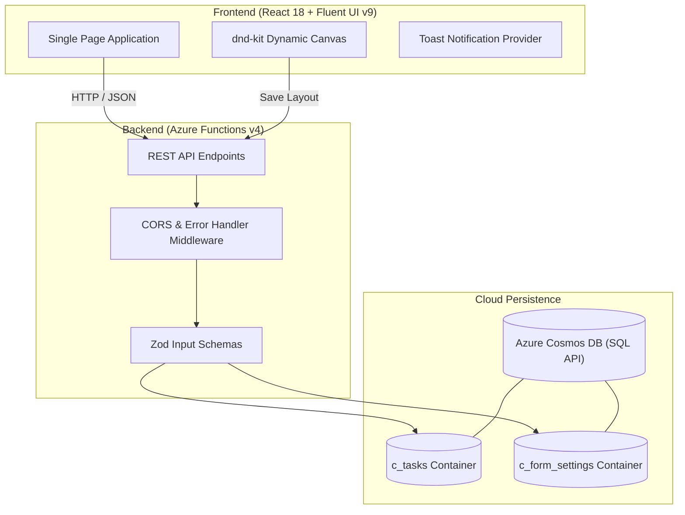

# TaskFlow - Enterprise Task Management & Dynamic Schema Form Builder

[](https://www.typescriptlang.org/)
[](https://react.dev/)
[](https://react.fluentui.dev/)
[](https://azure.microsoft.com/)
[](https://azure.microsoft.com/services/cosmos-db/)
[](https://jestjs.io/)
[](https://opensource.org/licenses/MIT)

**TaskFlow** is a decoupled full-stack enterprise task management platform featuring a **BPMN-inspired Drag-and-Drop Form Builder**. It allows organization administrators to dynamically construct custom form layouts in real time, automatically propagating custom fields to task models and data grids without requiring database migrations or code redeployment.

<details>
<summary><b>🇮🇩 Baca Dokumentasi Bahasa Indonesia (Klik untuk membuka)</b></summary>
<br />

### Halo sobat coding dan para suhu sekalian! 👋

Kenalin, ini **TaskFlow**, proyek *full-stack* yang saya racik untuk menjawab kebutuhan manajemen tugas kelas *enterprise* dengan kustomisasi form yang dinamis.

Salah satu *problem* klasik yang sering kita temuin: tiap kali admin butuh kolom baru di task, biasanya kita sebagai *engineer* harus repot bikin migrasi database, ubah skema, dan *re-deploy* API. Nah, di TaskFlow ini saya bikin alurnya jadi anti-ribet. Admin tinggal *drag-and-drop* field yang dimau lewat kanvas visual, dan kolom tersebut langsung aktif serta siap dipakai tanpa perlu utak-atik database sama sekali.

---

#### ⚙️ Gimana Cara Kerjanya di Balik Layar?
Buat urusan *tech stack*, di frontend saya pakai **React 18 + Microsoft Fluent UI v9** biar tampilannya kerasa *clean* dan punya standar *enterprise*. Fitur *drag-and-drop* form-nya saya percayakan ke `@dnd-kit` dengan inspirasi dari *form builder* ala BPMN.

Di sisi backend, arsitekturnya dibuat *serverless* pakai **Azure Functions v4 (Node.js + TypeScript) + Azure Cosmos DB**. Kenapa pilih Cosmos DB? Sifat NoSQL-nya yang *schema-less* itu jadi kunci: field kustom yang baru Anda racik bisa langsung tersimpan rapi ke dokumen JSON tanpa perlu pusing mikirin migrasi tabel.

---

#### 🧪 Nggak Cuma "Yang Penting Jalan"
Buat saya, kode yang bagus itu harus bisa dipertanggungjawabkan keamanannya dan gampang di-*maintain*. Makanya di sini saya pasang serangkaian pengujian:
- **Unit Testing**: Mulai dari *hook debounce* sampai *service* task yang sudah diuji pakai mock Cosmos DB.
- **Integration Testing**: Simulasi *workflow* komplit dari awal *load*, cari task, filter status, sampai ganti halaman paginasi.
- **Aksesibilitas (A11y)**: Sudah diaudit pakai `jest-axe` supaya memenuhi standar WCAG AA (ramah navigasi keyboard dan *screen reader*).
- **Keamanan & Error Handling**: Setiap data masuk disaring ketat pakai `Zod`, ada proteksi *whitelist* CORS, dan penanganan error dibuat terpusat pakai `AppError` biar nggak ngebocorin detail jeroan server ke user.

---

#### ☕ Ada Masukan atau Mau Ngobrol?
Tentu proyek ini masih jauh dari kata sempurna. Kalau Anda atau para suhu menemukan celah arsitektur yang bisa dioptimasi, nemu *bug*, atau ada *best practice* yang terlewat, jangan ragu buat colek saya lewat *Pull Request* atau bikin *Issue* ya! Masukan dari Anda bakal sangat berharga buat perkembangan saya ke depan.

</details>

---

## 🌟 Key Features

### 1. Enterprise Task Management
- **Fluent UI Data Grid**: Microsoft Fluent UI v9 data table with status indicators (`To Do`, `In Progress`, `Done`).
- **Dynamic Field Injection**: Automatically renders custom fields created in the Form Builder directly within the task grid and dialog.
- **Search & Filter Engine**: Real-time debounced search, status-based filtering, and responsive pagination.
- **Context-Aware States**: Clear visual feedback with custom empty states, loading skeletons, and accessible toast notifications.

### 2. BPMN-Style Drag-and-Drop Form Builder
- **Visual Canvas**: Built using `@dnd-kit`, featuring a palette toolbox and interactive drop canvas.
- **Supported Field Types**: Text, Date, Date-Time, and Email inputs.
- **Responsive Grid**: Supports up to 2-column responsive layout per row with live label editing.
- **Universal Schema Sync**: Saved schema configurations apply instantly across task dialogs and table views.

### 3. Serverless Architecture & Enterprise Security
- **Azure Functions v4**: Lightweight, scalable serverless REST endpoints built with Node.js and TypeScript.
- **Azure Cosmos DB**: Schema-less NoSQL document storage enabling zero-migration dynamic field persistence.
- **Type-Safe Validation**: Runtime input sanitization and schema enforcement powered by `Zod`.
- **Centralized Error Handling**: Standardized `AppError` and `withErrorHandler` masking internal server details.
- **CORS Whitelisting**: Strict origin controls protecting against unauthorized cross-origin requests.

---

## 🏗️ Architecture Overview



---

## 📁 Repository Structure

```text
taskflow/
├── frontend/                     # React 18 Single Page Application
│   ├── src/
│   │   ├── components/           # Reusable UI components (TaskDialog, etc.)
│   │   ├── contexts/             # Toast and application contexts
│   │   ├── hooks/                # Custom React hooks (e.g., useDebounce)
│   │   ├── pages/
│   │   │   ├── TaskList/         # Task management list and data grid
│   │   │   └── FormSettings/     # Drag-and-drop form canvas builder
│   │   ├── services/             # Type-safe API communication layer
│   │   └── types/                # TypeScript shared contracts
│   └── package.json
│
├── backend/                      # Azure Functions v4 REST API
│   ├── src/
│   │   ├── config/               # Cosmos DB client & container setup
│   │   ├── functions/            # HTTP trigger endpoints
│   │   ├── middleware/           # CORS and security middlewares
│   │   ├── models/               # Zod validation schemas and types
│   │   ├── services/             # Business logic layer
│   │   └── utils/                # Centralized error handler and utilities
│   └── package.json
│
└── docs/                         # Specifications & Architectural Documentation
    ├── architecture.md           # System design & component breakdown
    ├── design.md                 # UI/UX design specifications
    └── prd.md                    # Product requirements document
```

---

## 🧪 Comprehensive Testing Suite

The project includes an enterprise-grade test pyramid covering unit, integration, accessibility, and security scenarios:

```bash
# Frontend Testing
cd frontend
npm test                 # Run unit tests (useDebounce, API services, etc.)
npm run test:integration # Run full workflow tests (Filter, Search, Paginate)
npm run test:a11y        # Run WCAG compliance audit (jest-axe)

# Backend Testing
cd backend
npm test                 # Run unit tests with mocked Cosmos DB containers
npm run test:integration # Run schema format and CORS policy tests
```

---

## 🚀 Quick Start Guide

### Prerequisites
- [Node.js](https://nodejs.org/) (v18 or higher)
- [Azure Functions Core Tools](https://learn.microsoft.com/en-us/azure/azure-functions/functions-run-local) (`npm i -g azure-functions-core-tools@4`)
- [Azure Cosmos DB Emulator](https://learn.microsoft.com/en-us/azure/cosmos-db/local-emulator) (or active Azure Cosmos DB connection string)

### ⚡ All-in-One Command (From Project Root)
You can run both the Backend API and Frontend Client concurrently with a single command from the project root:
```bash
# Install root, backend, and frontend dependencies in one go
npm run install:all

# Start both services concurrently
npm run dev
# API: http://localhost:7071 | Client: http://localhost:3000
```

### Manual Individual Setup
```bash
cd backend
npm install

# Configure local settings
cp local.settings.example.json local.settings.json
# Update COSMOS_DB_CONN_STRING with your Cosmos DB connection string

npm start
# API starts listening on http://localhost:7071
```

### 2. Frontend Setup
```bash
cd frontend
npm install
npm start
# Client application opens on http://localhost:3000
```

---

## 🛡️ Security & Quality Best Practices

- **Self-Documenting Code**: Clear variable semantics and clean separation of concerns following industry standards.
- **Defensive Error Handling**: Catch blocks utilize type guards (`error: unknown` with `instanceof Error`) preventing unhandled rejections.
- **WCAG AA Compliance**: Tested with `jest-axe` to ensure high contrast, keyboard navigation, and proper ARIA labeling.

---

## 📄 License
This project is open-source and available under the [MIT License](LICENSE).
